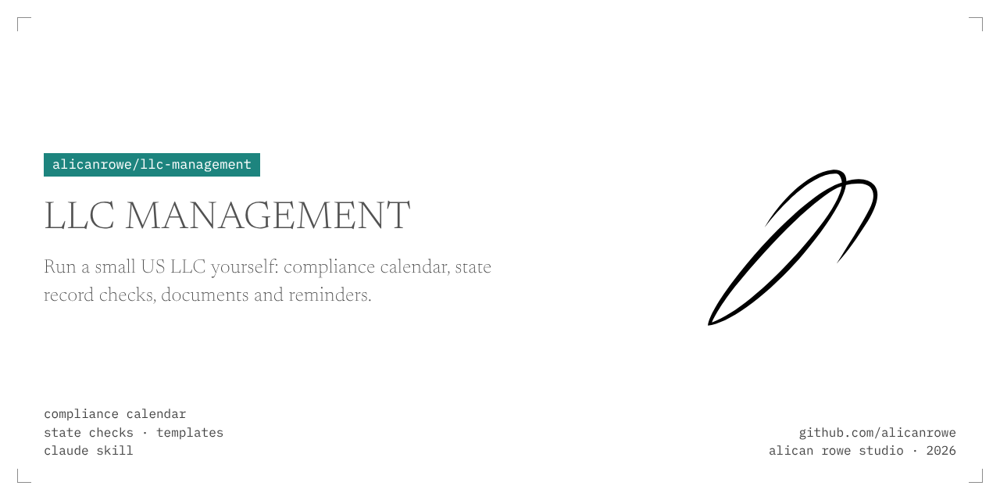

# llc-management

A Claude skill for running a small US LLC yourself after formation, instead of paying a compliance service.

It has Claude:

- keep a compliance calendar with deadlines, statutes, fees and status
- check the state's public record before trusting any provider's status
- keep the formation documents in one folder
- wind down a formation provider (such as LegalZoom or Northwest) safely, with special care for the registered agent and in-progress filings
- draft filings and agreements for you to review, without submitting, signing or paying on its own
- set dated reminders
- find, compare and equip a workshop space (research and drafts only; you contact landlords and sign)

## Install

Copy this folder to `~/.claude/skills/llc-management/`. Then copy `templates/entity.example.md` to `entity.md` and fill in your LLC's details, or ask Claude to do it with you. `entity.md` is git-ignored so your personal details stay local.

## State references

- `references/new-york.md`: public record search, agent for service of process, operating agreement (§417), publication (§206), biennial statement, and a step-by-step Certificate of Change (DOS-1359-f) for taking a formation service off the record when it won't stop auto-renewing.

- `references/workshop-space-nyc.md`: NYC shop space sources (GMDC, Industry City, Brooklyn Army Terminal, shared woodshops), what to ask a landlord, and rules worth knowing.
- `references/woodshop-tools.md`: an essential tool list for a small solid-wood furniture shop, with dated prices.

For another state, Claude researches the Secretary of State's site and writes a new reference file in the same shape.

## Not legal or tax advice

The skill helps you stay organized and on time. For legal or tax questions, ask a lawyer or accountant.
